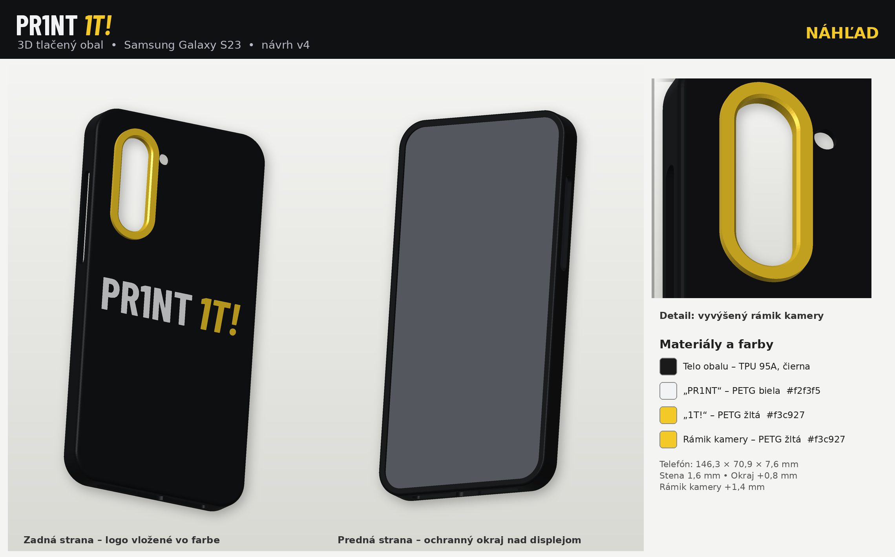

# PR1NT 1T! – obal Samsung Galaxy S23 (návrh v4)



## Diely (stl/)
| Súbor | Materiál | Farba |
|---|---|---|
| 01_obal_TPU_cierny.stl | TPU 95A | čierna |
| 02_logo_PR1NT_biela.stl | PETG (alebo PLA) | biela #f2f3f5 |
| 03_logo_1T_zlta_f3c927.stl | PETG (alebo PLA) | žltá #f3c927 |
| 04_ramik_kamery_zlta_f3c927.stl | PETG | žltá #f3c927 – tlačí sa samostatne |

Logo „PR1NT 1T!“ podľa webu pr1nt1t.sk – písmo Barlow Condensed Bold / Bold Italic (OFL, v `fonts/`).

## Tlač
- Diely 01–03 načítaj naraz ako **jeden objekt s viacerými časťami** (súradnice sedia). Zadná strana leží na podložke, logo sa tlačí v prvých 3 vrstvách (0,6 mm) zarovno s povrchom.
- Odporúčam **PETG** na vložky – s TPU drží lepšie ako PLA.
- TPU: 0,2 mm vrstva, 3 obvody, výplň 100 % (alebo 4 obvody + 40 % gyroid), pomalá rýchlosť 20–40 mm/s.
- Rámik kamery (04): tlač plochou stranou dole, potom zatlač čapom do otvoru v obale zvonku a podlep kvapkou CA lepidla.

## Úpravy
Všetky rozmery sú v `generate_case.py` (vôľa `CLR`, hrúbky, pozícia kamier, tlačidiel, loga).
```
pip install manifold3d shapely matplotlib numpy pillow fonttools
python3 generate_case.py && python3 render_preview.py
```
⚠️ Pozície výrezov (kamery, tlačidlá, USB-C) sú podľa verejných rozmerov S23 – pred sériou over skúšobnou tlačou.
