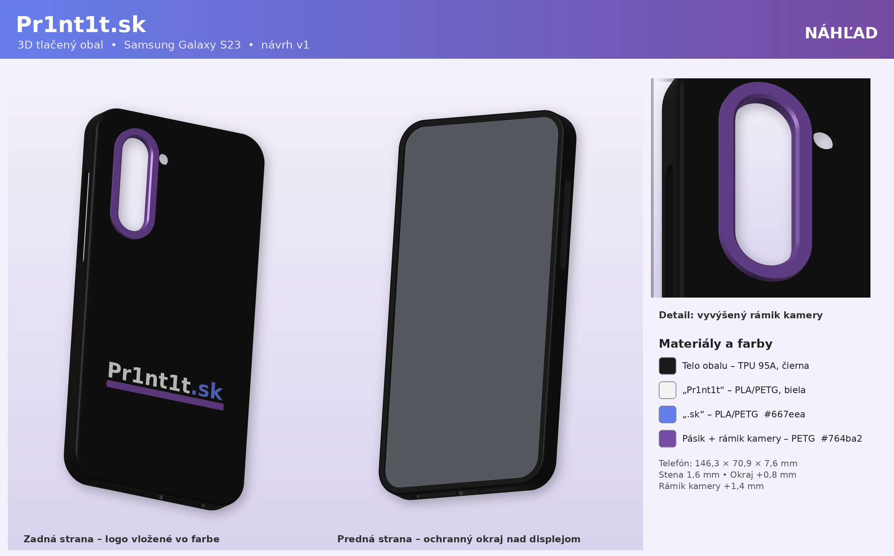

# Pr1nt1t.sk – obal Samsung Galaxy S23 (návrh v1)



## Diely (stl/)
| Súbor | Materiál | Farba |
|---|---|---|
| 01_obal_TPU_cierny.stl | TPU 95A | čierna |
| 02_logo_Pr1nt1t_biela.stl | PETG (alebo PLA) | biela |
| 03_logo_sk_modra_667eea.stl | PETG (alebo PLA) | #667eea |
| 04_logo_pasik_fialova_764ba2.stl | PETG (alebo PLA) | #764ba2 |
| 05_ramik_kamery_fialova_764ba2.stl | PETG | #764ba2 – tlačí sa samostatne |

## Tlač
- Diely 01–04 načítaj naraz ako **jeden objekt s viacerými časťami** (súradnice sedia). Zadná strana leží na podložke, logo sa tlačí v prvých 3 vrstvách (0,6 mm) zarovno s povrchom.
- Odporúčam **PETG** na vložky – s TPU drží lepšie ako PLA.
- TPU: 0,2 mm vrstva, 3 obvody, výplň 100 % (alebo 4 obvody + 40 % gyroid), pomalá rýchlosť 20–40 mm/s.
- Rámik kamery (05): tlač plochou stranou dole, potom zatlač čapom do otvoru v obale zvonku a podlep kvapkou CA lepidla.

## Úpravy
Všetky rozmery sú v `generate_case.py` (vôľa `CLR`, hrúbky, pozícia kamier, tlačidiel, loga).
```
pip install manifold3d shapely matplotlib numpy pillow
python3 generate_case.py && python3 render_preview.py
```
⚠️ Pozície výrezov (kamery, tlačidlá, USB-C) sú podľa verejných rozmerov S23 – pred sériou over skúšobnou tlačou.
